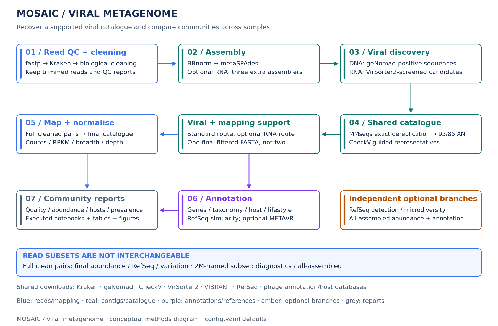
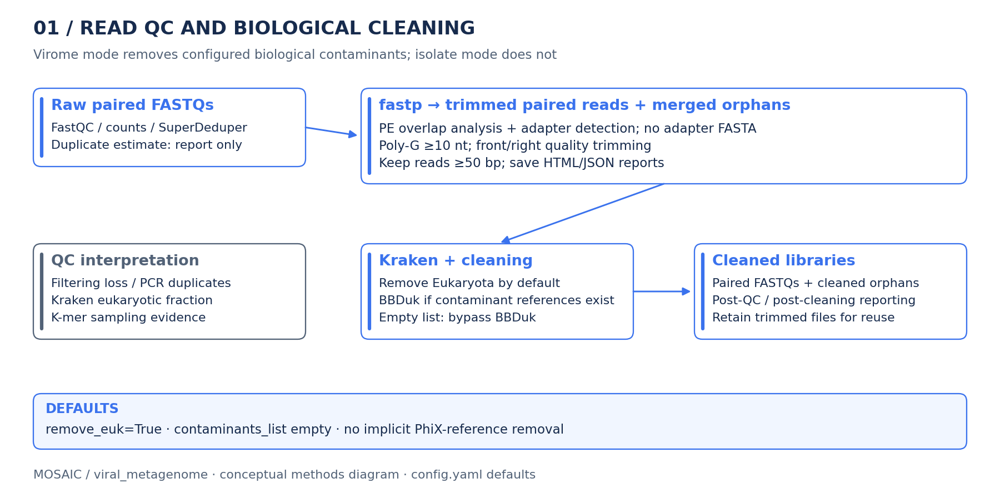
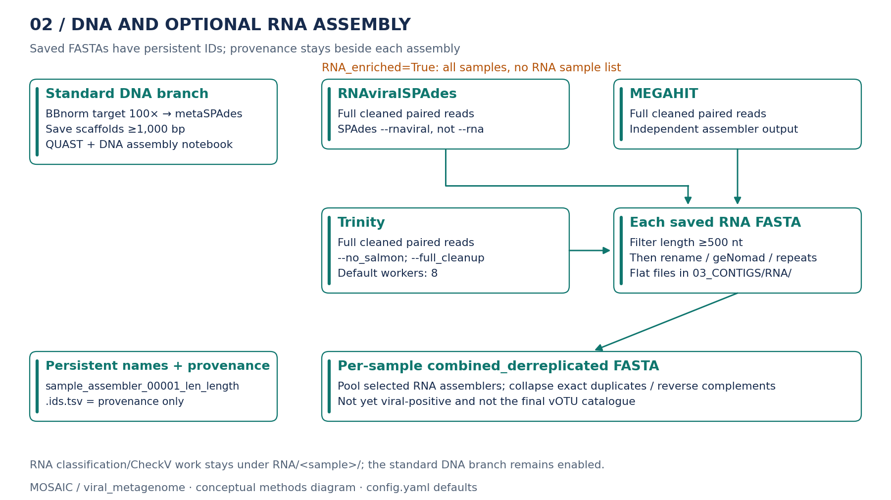
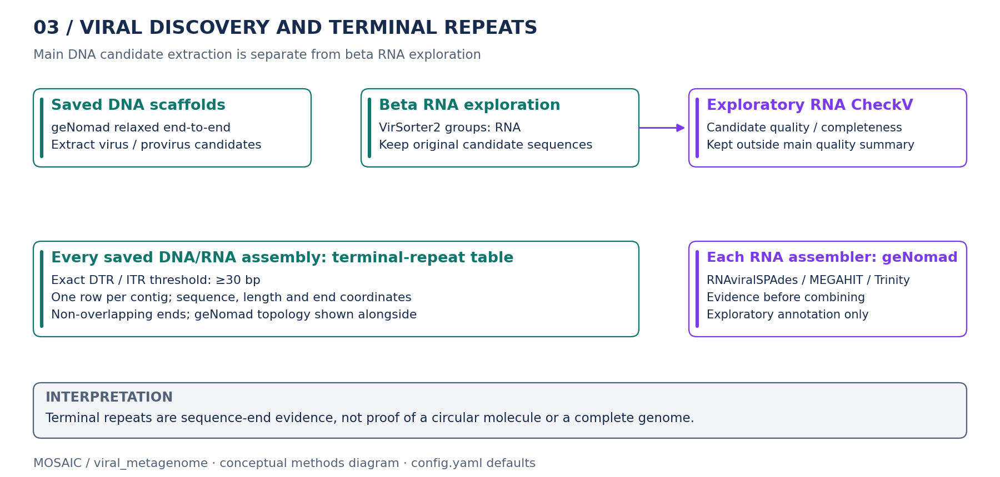
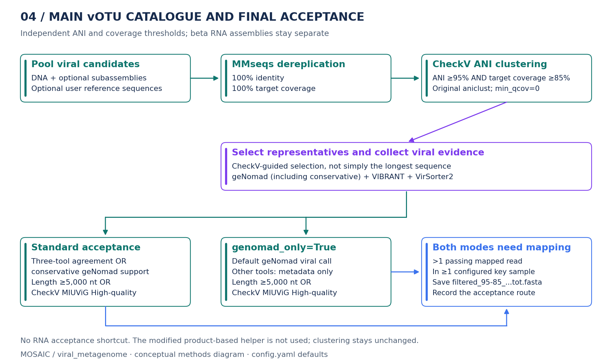
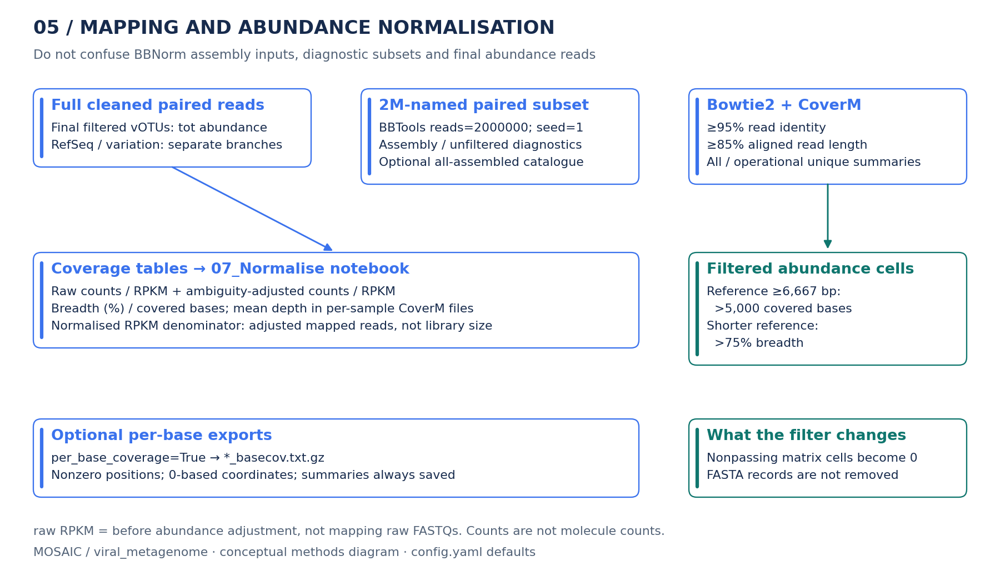
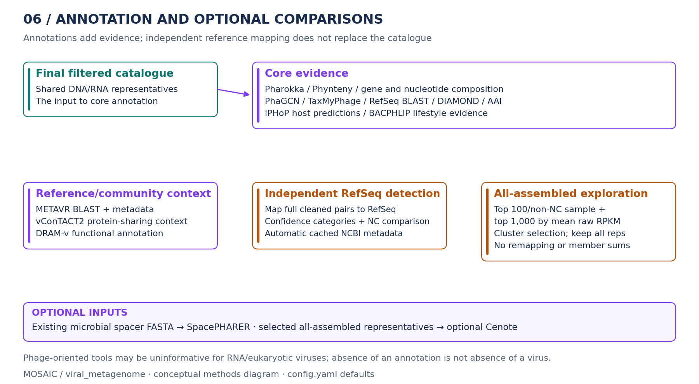
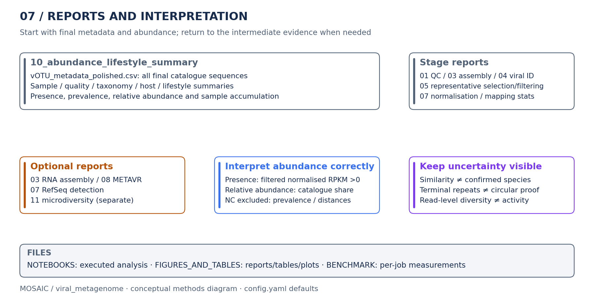

# Viral metagenome recovery and community profiling

The viral metagenome workflow recovers a supported viral catalogue from a collection of sequencing libraries, then describes its abundance, genome quality, taxonomy, potential hosts and gene content. The main research question is which viral populations are present and how they vary between samples, not whether each library contains one pure virus.

Unlike the [phage isolate workflow](isolate_purity.md), it uses viral classification as a selection gate. A sequenced virome can contain many genomes, incomplete assemblies and non-viral reads; one contig or 100% read recruitment is not an expected outcome. Sequences that do not pass the final viral filter remain in the saved assemblies and intermediate results, but not in the final filtered vOTU FASTA.

This guide covers paired-end Illumina `viral_metagenome`, which is the wrapper mode for the Snakemake target `runWorkflow`. Long-read and hybrid modes have separate targets; they are not enabled by the RNA flag.

## Quick start

Activate `Mosaic_workflow` and run from `mosaic/`:

```bash
python mosaic.py run viral_metagenome \
  --raw /path/to/project/00_RAW_DATA \
  --assembly-stats \
  -j 32 -k -p --dry-run
```

Remove `--dry-run` to execute. This example enables the mapping-statistics report; omit `--assembly-stats` for the core workflow without that additional comparison. The wrapper enables Conda and rerunning incomplete jobs by default, prints the Snakemake command, and selects `metagenome=True`, `isolates=False`, `microbial=False`, `sourmash_clean_reads=False` and `remove_euk=True`.

The equivalent direct command, using the repository's virome defaults, is:

```bash
snakemake --use-conda -p runWorkflow \
  --config input_dir=/path/to/project/00_RAW_DATA assembly_stats=True \
  -j 32 -k --rerun-incomplete -n
```

Remove `-n` to execute. Direct Snakemake commands inherit `config.yaml`; the wrapper explicitly applies its mode preset. If you have edited biological defaults in the YAML, check the printed startup settings before treating the two commands as equivalent.

For a new server, follow the [installation instructions](../README.md#installation) first. Existing tools/databases are reused; missing default dependencies are downloaded when a scheduled rule requires them. No obsolete `--virsorter` flag is needed: VirSorter2 is already part of catalogue filtering.

## Inputs and project layout

```text
project/
├── 00_RAW_DATA/
│   ├── ViromeA_R1.fastq.gz
│   ├── ViromeA_R2.fastq.gz
│   ├── ViromeB_R1.fastq.gz
│   └── ViromeB_R2.fastq.gz
├── key_samples_list.csv          # optional: one sample ID per line
└── sample_metadata.csv           # optional: sample column and grouping metadata
```

| Input | Requirement |
| --- | --- |
| Paired Illumina FASTQs | Required. Defaults are `{sample}_R1.fastq.gz` and `{sample}_R2.fastq.gz`. Samples are discovered from reverse-read filenames and naturally sorted; every discovered sample needs its matching forward FASTQ. |
| Read tags | Override `forward_tag` and `reverse_tag` if the filename convention differs. For the wrapper, use repeated `--config forward_tag=...` / `--config reverse_tag=...`. |
| `config.yaml` and Conda | Use the repository configuration and workflow environment. Command-line config overrides the YAML; the wrapper also supplies its biological preset. |
| `key_samples_list.csv` | Optional file under the results directory, controlled by `key_samples`. Despite its extension, the current reader expects one sample ID per line, without a header. It restricts the samples that can provide final catalogue mapping support; it does not restrict assembly or abundance reporting to those samples. Without it, every discovered sample is a key sample. |
| Sample metadata CSV | Optional `abundance_sample_metadata` with unique `sample` IDs matching the libraries. `abundance_group_column` selects a grouping column for the final abundance report. |
| Microbial spacer FASTA | Optional existing file supplied through `microbial_spacers`. It enables SpacePHARER matching; this virome target does not assemble microbial libraries or extract their spacers. |
| User reference FASTA | Optional `additional_reference_contigs`. These sequences join catalogue construction and receive CheckV assessment. Independent read mapping to that reference is a separate target. |
| Negative-control sample | Optional `negative_control`, matching a sample ID in `00_RAW_DATA`. The control's paired FASTQs must be present. Its role is branch-specific, not automatic removal from the whole workflow. |

By default, results are written in the parent directory of `00_RAW_DATA`. Use wrapper `--results /path/to/results` or direct config `results_dir=/path/to/results` to change that location. Place the key-sample file under the selected results directory; use absolute paths for supplied sample metadata and spacer FASTAs to avoid working-directory ambiguity. Bacterial host FASTAs and isolate host-assignment metadata are not prerequisites for this workflow.

### Databases and tools

Database paths such as `db/RefSeqViral/RefSeq_viral.fasta` are relative to the workflow directory, not the raw-read directory. Their shared data are separate from project results. First execution needs network access, disk space and permission to create Conda environments, `db/` and `tools/`.

| Existing download rule | Used for |
| --- | --- |
| `downloadKrakenDB`, `getKrakenTools` | Read classification and optional eukaryotic removal. The configured default is the repository-relative PlusPFP Kraken database. |
| `downloadSourmashRocksDB`, `downloadSourmashTaxonomy` | Optional shared clean-read GTDB RS226 bacterial/archaeal profiling. |
| `downloadContaminants` | Configured accession-based contaminant references, only when the list is nonempty. |
| `downloadGenomadDB` | Initial DNA discovery, individual RNA assembly evidence and representative-level classification. |
| `downloadCheckvDB` | Candidate quality/completeness and representative selection. |
| `downloadVirSorterDB`, `get_VIBRANT` | Representative-level viral evidence; VirSorter2 also screens combined RNA assemblies when enabled. |
| `downloadRefSeqViral` | Core nucleotide similarity searches; optional independent RefSeq mapping reuses the same FASTA. A UTC-dated snapshot, hashes/download manifest and undated symlinks record the active copy. Download date is not the NCBI release date. |
| `downloadBLASTviralProteins` | Viral protein references for DIAMOND annotation. |
| `downloadPharokkaDB`, `downloadPhyntenyDB` | Gene annotation and synteny evidence. |
| `downloadPhaBOXDB`, `downloadTaxmyphageDB`, `downloadIphopDB` | PhaBOX 2 PhaGCN taxonomy, TaxMyPhage and potential host predictions. |
| `downloadVcontact2Files`, `getClusterONE` | Optional vConTACT2 reference context and clustering. |
| `downloadDRAMDB` | Optional DRAM-v annotation. |
| `downloadMetaVR` | Optional METAVR nucleotide BLAST database and reporting metadata. |
| `downloadCenoteDB` | Optional Cenote-Taker3 annotation of abundance-selected all-assembled representatives. |

Download rules provide their declared default locations; setting an arbitrary nonexistent custom path does not create a new downloader for it. On another server, leave repository-relative defaults in place or point to existing compatible databases. In particular, Kraken needs the actual database directory, not its parent or an old server-specific path. Keep database versions and download manifests for reproducibility.

## Workflow overview



[Zoomable overview (SVG)](figures/viral_metagenome_overview.svg)

The diagrams describe biological steps, not individual Snakemake jobs. Blue is reads/mapping, teal is contigs/catalogues, purple is annotations/references, amber is optional branches, and grey is reports. Thresholds are the repository defaults; config overrides can change the named settings.

| Step | What happens |
| --- | --- |
| [1. Read QC and biological cleaning](#1-read-qc-and-biological-cleaning) | fastp trims technical/low-quality sequence. Kraken classifies reads; configured eukaryotic/contaminant removal produces cleaned paired and orphan FASTQs. |
| [2. DNA and optional RNA assembly](#2-dna-and-optional-rna-assembly) | BBNorm supplies DNA assembly inputs for metaSPAdes. Optional RNAviralSPAdes, MEGAHIT and Trinity run independently on full cleaned paired reads. Saved assemblies receive persistent names and QUAST summaries. |
| [3. Viral discovery and terminal repeats](#3-viral-discovery-and-terminal-repeats) | geNomad extracts DNA viral candidates; optional combined RNA assemblies undergo a VirSorter2 screen. CheckV and per-assembly terminal-repeat/geNomad evidence remain available. |
| [4. Shared vOTU catalogue and final acceptance](#4-shared-votu-catalogue-and-final-acceptance) | Pool candidates, exactly dereplicate, cluster at independent 95% ANI / 85% target coverage, select representatives and apply viral plus mapping-support criteria. |
| [5. Mapping and abundance normalisation](#5-mapping-and-abundance-normalisation) | Full cleaned pairs map to the final catalogue. Save all/unique summaries, raw/adjusted abundance and length-dependent coverage-filtered matrices. Diagnostic mappings use a separate small subset. |
| [6. Annotation and optional comparisons](#6-annotation-and-optional-comparisons) | Gene content, taxonomy, host/lifestyle evidence and reference similarity. Optional RefSeq detection, METAVR, DRAM-v, vConTACT2 and all-assembled exploration answer additional questions. |
| [7. Reports and interpretation](#7-reports-and-interpretation) | Final vOTU metadata and community summaries, executed notebooks, tables and figures. Optional microdiversity has its own notebook. |

Regenerate the diagrams from the repository root:

```bash
python mosaic/docs/generate_virome_diagrams.py
```

The documentation-only generator reuses the isolate manual's compact layout, reads configurable values from `config.yaml` and saves PNG plus editable-text SVG under `mosaic/docs/figures/`. It needs matplotlib and PyYAML from the workflow environment; it does not run Snakemake, download databases or edit project results. Fixed alignment/clustering/reporting policies are explicit in its labels and must be updated if those policies change.

## 1. Read QC and biological cleaning



[Zoomable read-QC diagram (SVG)](figures/viral_metagenome_01_read_qc.svg)

fastp uses paired-end overlap analysis plus `--detect_adapter_for_pe`, explicit poly-G trimming and front/right quality trimming. No adapter FASTA is supplied. Defaults include minimum read length 50 bp and poly-G run length 10 nt; the [fastp guide](fastp_trimming.md) lists all named settings. Trimmed pairs and merged orphan reads remain available for reuse.

FastQC/MultiQC, read counts, SuperDeduper and k-mer sampling supply QC evidence. SuperDeduper estimates duplicates from raw pairs for reporting; its deduplicated reads are not assembly or abundance inputs. Duplicate warnings are not deduplicated molecule counts or automatic evidence of contamination.

`sourmash_clean_reads=True` adds a shared report on full final-clean pairs and orphans, using GTDB RS226 for bacterial/archaeal signal. It includes per-sample profiles, a pooled profile, supported/weak reference evidence and plots in `01_sourmash_clean_reads.tot.ipynb`/HTML. It replaces the old trimmed-read `sourmash` option, does not remove reads and is not a viral classifier. See [clean-read Sourmash](sourmash_clean_reads.md).

Virome mode removes Kraken-classified Eukaryota by default (`remove_euk=True`, `contaminants_taxid=2759`). An explicit nonempty `contaminants_list` additionally enables BBDuk reference filtering. An empty list bypasses that reference filter; it does not disable eukaryotic removal. With neither biological filter active, compressed inputs can be passed through as relative symlinks instead of copies. PhiX is not appended implicitly to the contaminant list. Kraken post-cleaning reports remain part of virome QC, unlike the isolate bypass.

Use wrapper `--no-remove-euk` or direct `remove_euk=False` when retaining that read fraction is intentional. `RNA_enriched=True` does not change the virome eukaryotic-removal policy. Inspect cleaning losses and classification reports before interpreting low read recruitment as a biological result.

## 2. DNA and optional RNA assembly



[Zoomable assembly diagram (SVG)](figures/viral_metagenome_02_assembly.svg)

The standard branch uses BBNorm-normalised cleaned-library inputs with target `max_norm=100`, then SPAdes in `--meta` mode. Paired and orphan assembly inputs are included. Save scaffolds meeting `min_len` (default 1,000 bp) and the configured assembler-coverage filter `min_cov` (default 0). This initial assembler filter is not the later mapped-read coverage/breadth filter. Reference-free QUAST and `03_assembly_short.tot.ipynb` describe the saved DNA assemblies.

Identifiers use `sample_assembler_number_len_length`, for example `ViromeA_metaspades_00001_len_1000`. Numbering follows saved-record order with width `max(5, number of digits in the saved contig count)`; 200,000 saved contigs therefore start at `000001`. The neighbouring `.ids.tsv` preserves original headers/descriptions for provenance. Downstream tools use the named FASTA, not ID translation through that sidecar. See [contig identifiers](contig_identifiers.md).

MOSAIC-written FASTAs use one header line and one complete sequence line per record, including saved DNA/RNA assemblies, candidate exports and selected cluster representatives. FASTA splits also disable wrapping. Sequence content and identifiers are unchanged; downloaded databases and third-party working files can retain their native formatting.

### RNA enrichment

`RNA_enriched=True` adds RNAviralSPAdes (`--rnaviral`, not ordinary `--rna`), MEGAHIT and Trinity for every paired-end sample. There is no `rna_samples` list and no need to separate mixed RNA/DNA libraries. The DNA branch remains enabled. These RNA assemblers use full cleaned paired reads before BBNorm or mapping subsampling, not raw reads or orphans.

Each saved RNA assembler FASTA is filtered at `rna_min_contig_length` (default 500 nt, inclusive) before naming, geNomad, terminal-repeat testing or combination. FASTAs and `.ids.tsv` files are directly under `03_CONTIGS/RNA/`; per-tool classification, CheckV and working outputs remain under `RNA/{sample}/`.

Within each sample, selected RNA assemblies are pooled and exact duplicate/reverse-complement sequences are collapsed into `{sample}_combined_derreplicated.fasta`. This file is not viral-positive and is not a final vOTU catalogue. Its provenance table records contributing named sequences. Each assembler also has its own geNomad evidence; the RNA notebook and RNA QUAST report compare individual and combined assemblies.

Trinity uses `--no_salmon`, `--full_cleanup` and a separate Butterfly heap setting. Start with 8 Trinity workers; RNAviralSPAdes and MEGAHIT default to 16 threads. See the [RNA guide](rna_microdiversity.md) for commands, reconciliation, file locations and recovery/cleanup behaviour.

## 3. Viral discovery and terminal repeats



[Zoomable viral-discovery diagram (SVG)](figures/viral_metagenome_03_discovery.svg)

Initial short-read DNA discovery runs geNomad with its relaxed preset on saved scaffolds and extracts virus/provirus candidates to `04_VIRAL_ID/{sample}_positive_viral_contigs.tot.fasta`. This candidate FASTA is different from the whole assembly. CheckV assesses candidate quality, completeness, contamination and provirus evidence; these assessments later inform representative selection.

When RNA enrichment is enabled, VirSorter2 screens each combined RNA assembly with `rna_viral_groups` (default `RNA`). Its final candidate FASTA is exposed through the relative symlink `03_CONTIGS/RNA/{sample}_virsorter2_RNA_viral_positive.fasta`. CheckV processes this positive FASTA, not the unscreened `combined_derreplicated` assembly. RNA candidates enter the shared `tot` catalogue before clustering.

The circularity rule produces one row for every saved DNA/RNA contig, including ones without a geNomad viral call. It reports exact DTR/ITR sequence-end overlaps, repeat sequences, lengths, 1-based inclusive end coordinates and available geNomad topology/scores. The default reporting threshold is 30 bp. End windows are bounded by half the contig length, preventing the same contig positions from serving as both ends; geNomad DTR evidence can extend the usual 5 kb search window without removing that bound. Repeats are evidence for genome-end structure, not proof of physical circularity, completeness or replication.

## 4. Shared vOTU catalogue and final acceptance



[Zoomable catalogue diagram (SVG)](figures/viral_metagenome_04_catalogue.svg)

DNA candidates and optional RNA/subassembly/coassembly/user-reference candidates are pooled. MMseqs exact dereplication uses `--min-seq-id 1 -c 1 --cov-mode 1`. Representative sequences and membership tables are preserved; redundant `all_seqs.fasta` exports are removed after success. These are the existing exact settings, not a guarantee that every grouped member has the same full length.

The shared `vOUTclustering` rule calculates BLAST-based ANI through `anicalc_checkv.py`, then invokes CheckV's original installed clustering command:

```bash
aniclust --fna ... --ani ... --out ... \
  --min_ani 95 --min_tcov 85 --min_qcov 0
```

ANI and target coverage must pass independently. The modified product-based `scripts/aniclust_checkv.py` is not used or edited. Representative selection then uses the existing CheckV completeness, quality and warning logic; the final representative is not necessarily the longest member. Selection and original membership remain inspectable in the intermediate tables/notebook.

### Final acceptance routes

The selected representative undergoes geNomad, VIBRANT and VirSorter2 assessment. Standard acceptance requires:

```text
(all three viral tools support the representative OR conservative geNomad support)
AND (CheckV-recorded length >= min_votu_length OR CheckV MIUViG quality = High-quality)
AND mapping support
```

`min_votu_length` defaults to 5,000 nt. The quality exception uses the existing `checkV_miuvig_quality` field, not an independently invented completeness cutoff.

With RNA enrichment enabled, an additional route requires the selected representative itself to be in the final representative-level VirSorter2 positive list, have `max_score_group=RNA`, meet `rna_min_contig_length` and have mapping support. It does not require three-tool agreement or a high CheckV assessment. An RNA assembler name, or RNA evidence only on another cluster member, does not qualify it.

For both routes, mapping support is **filtered read count >1 in at least one configured key sample**, using the unfiltered-representative catalogue mapping. This small support requirement is separate from the stricter per-sample abundance coverage filter and microdiversity callability thresholds.

There is only one final catalogue:

```text
05_vOTUs/filtered_95-85_positive_viral_contigs.tot.fasta
```

RNA enrichment does not create a second RNA final vOTU FASTA or use CD-HIT for catalogue clustering. `vOTU_clustering_summary.tot.csv` records retained-representative evidence and `acceptance_route` (`standard`, `RNA` or `standard+RNA`). `vOTU_filtering_audit.tot.tsv` also saves every assessed representative, actual pass/fail flags and exclusion reasons; the accepted-only summary and filtering criteria are unchanged. Custom catalogue names change the prefix, not this shared-catalogue design.

## 5. Mapping and abundance normalisation



[Zoomable mapping diagram (SVG)](figures/viral_metagenome_05_mapping.svg)

Final `tot` abundance maps full cleaned paired reads to the final filtered catalogue. BBNorm assembly reads and the diagnostic subset are not used as substitutes. Orphans contribute to DNA assembly, but these virome catalogue/RefSeq abundance mappings use paired inputs; isolate mapping has a different full-paired-plus-orphan policy.

| Analysis | Virome read input |
| --- | --- |
| Standard DNA assembly | BBNorm-normalised cleaned pairs and orphans. |
| Optional RNA assembly | Full cleaned `tot` pairs, before BBNorm/subsampling. |
| Final catalogue `tot` abundance | Full cleaned `tot` pairs. |
| Assembly/viral/unfiltered-catalogue diagnostic mapping | `2M_...` paired FASTQs made by `reformat.sh reads=2000000 sampleseed=1`; a smaller library can yield fewer reads. This is a separate sampling command, not the optional `subsampling` branch. |
| Optional all-assembled mapping | The same `2M_...` diagnostic subset. |
| Optional RefSeq detection and microdiversity | Full cleaned `tot` pairs, with their own mappings. |
| Optional `sub` catalogue abundance | A separate per-sample subset selected by the subsampling notebook. |

Bowtie2 mapping is deterministic; the abundance/diagnostic mappings use CoverM filtering at >=95% read identity and >=85% aligned read length. All passing-alignment and operationally unique subsets receive counts, depth, covered-base and RPKM summaries. In virome mode the unique heuristic selects proper pairs without `XS:i:`; it is not proof that every selected read has only one possible genomic origin. Counts are alignment/read measurements, not deduplicated molecule counts.

`mapping_max_insert_bp` defaults to 1,000 bp and supplies Bowtie2 `-X` consistently to all paired-end mapping rules, including diagnostics, catalogue/RefSeq abundance, polishing, microbial and microdiversity mapping. This is the maximum concordant fragment span, not a hard read-length or identity filter; discordant/single-mate alignment behavior is otherwise unchanged. Override it using `--config mapping_max_insert_bp=1500`. Changing the value requires regenerating the affected mappings. Single-end and long-read rules are unaffected.

`07_Normalise.tot.ipynb` preserves the existing ambiguity adjustment based on all/unique coverage and a 200 uniquely covered-base requirement. Adjusted RPKM uses its adjusted mapped-read denominator, not the number of all sequenced reads. `raw` in `RPKM_raw_tot.txt` means before abundance adjustment, not mapping raw FASTQs. Merged `.txt` matrices are **comma-separated**; per-sample CoverM `.txt` files are tab-separated.

Filtered abundance matrices keep a sample/reference value only when:

```text
reference length >= 6,667 bp AND >5,000 covered bases
OR reference length < 6,667 bp AND >75% breadth
```

Nonpassing cells become zero; this matrix filter does not delete FASTA records. Separate `filtered_75_` RPKM matrices use >75% breadth at every reference length. These abundance-report policies are distinct from catalogue acceptance and the optional RefSeq detection categories.

`assembly_stats=True` adds `07_mapping_statistics_tot.ipynb` and HTML, comparing read recruitment to assembled, viral, unfiltered and filtered catalogues. These are independent mappings, not mutually exclusive read-accounting categories. `map_to_all_assembled=True` also requests this report and adds its full-dereplicated-catalogue comparison.

Optional per-base exports are off by default. `per_base_coverage=True` saves `*_basecov.txt.gz` containing tab-separated contig, 0-based position and positive depth. Missing positions represent zero depth. Counts, RPKM, CoverM breadth and mean depth remain available without those exports. Microdiversity produces its own positional output independently.

## 6. Annotation and optional comparisons



[Zoomable annotation diagram (SVG)](figures/viral_metagenome_06_annotation.svg)

Core annotation includes Pharokka/Phynteny, predicted genes and coding/nucleotide composition, PhaGCN and TaxMyPhage taxonomy, RefSeq nucleotide BLAST, viral-protein DIAMOND searches, AAI comparisons, iPHoP host predictions and BACPHLIP lifestyle evidence. Genome-organisation visualisation uses `lovis4u` by default, or `clinker`, only when the final catalogue has fewer than `visualization_max_contigs` sequences (default 50). Larger catalogues still receive the core annotation/reporting outputs.

PhaGCN taxonomy now runs through PhaBOX 2's `--task phagcn`, using a dedicated
CPU-only environment and automatically downloaded v2.2 database. The existing
2,000 bp classification cutoff, report filename and family/score labels are
retained; full PhaBOX lineage/source fields are added. No other PhaBOX task or
catalogue filtering is introduced. See [PhaBOX taxonomy](phabox_taxonomy.md).

Phage-oriented taxonomy, host and lifestyle tools are not automatically applicable to every RNA, ssDNA or eukaryotic virus. The final abundance/lifestyle report keeps source evidence while marking recognised non-dsDNA-phage groups as not applicable for its phage-lifestyle summary. A missing prediction is not evidence that a sequence is non-viral.

### Optional representative Sourmash screening

`sourmash_contig_catalogue=True` adds GTDB microbial-similarity evidence to
`vOTU_metadata_polished.csv` and, when all-assembled mapping is enabled, to
`all_assembled_top_contigs_metadata_tot.tsv`. Only representatives at least
`sourmash_contig_catalogue_min_length` (default 5,000 bp) are searched. Shorter
and no-match rows remain in metadata with their screening status. The existing
rules, database and isolate evidence parser are reused; no filtering, ranking,
host assignment or abundance measurement is changed. See
[representative screening](sourmash_contig_catalogue.md).

### Independent RefSeq detection

`map_to_RefSeq=True` maps full cleaned pairs directly to RefSeq Viral, independently of assembled vOTUs. It saves separate count/RPKM/breadth/depth results and executes `07_RefSeq_detection.py.ipynb`. The report retrieves NCBI metadata in Python using batched requests and cached results, rather than requiring a supplied metadata table.

The named RefSeq thresholds define high-confidence, candidate, ambiguous and not-detected calls. `negative_control` enables abundance/enrichment comparison and control-supported potential-contaminant reporting. Red contaminant rows and stars in heatmaps preserve pre-control coverage support; they are not automatically final sample detections. RefSeq similarity is not a definitive species identification. See [RefSeq mapping and detection](refseq_mapping.md) for criteria, control handling, output names and plotting conventions. This report does not alter `07_Normalise.py.ipynb` or the assembled viral catalogue.

### All-assembled exploration and optional Cenote

`map_to_all_assembled=True` combines all saved standard assemblies and, if RNA enrichment is enabled, every selected individual RNA assembly, irrespective of viral calls. Exact MMseqs representatives receive one mapping of the `2M_...` subset and the usual raw/normalised abundance outputs.

Selection uses the union of the top `all_assembled_top_per_sample` nonzero contigs per non-NC sample (default 100) and the top `all_assembled_cluster_top_n` by mean raw RPKM across non-NC samples (default 1,000). There is no 1,000-contig cap. The selected FASTA undergoes the shared independent 95/85 clustering; every resulting representative is kept, with no final top-100 cap.

Existing `all_assembled_top_contigs` filenames refer to that full selected-cluster representative set. Its annotation metadata's abundance columns remain the representative's measurements from the first full-catalogue mapping, **not summed cluster-member abundance**. The same up-to-2-million cleaned read pairs are now also mapped independently to this selected set. New measurements use the `all_assembled_top` mapping prefix and are reported alongside the full-catalogue proper-pair percentage in `07_mapping_statistics_tot.ipynb`. `07_all_assembled_top_abundance.tot.ipynb` exports remapped raw RPKM/counts/breadth/depth and displays a raw-RPKM clustermap, also displayed in mapping statistics. A separate membership table preserves original/dereplicated/selected-cluster relationships; metadata records cluster size rather than listing every member in one cell.

This virome mode also generates `all_assembled_top_contigs_review_tot.csv`/`.tsv`
in `03_CONTIGS/ALL_ASSEMBLED`.
The compact table keeps all representatives, three-tool calls, CheckV/terminal-repeat
evidence, original abundance and METAVR genome type/taxonomy. It traces actual
catalogue exclusions and cluster/region associations using the filtering audit.
It does not import SeqHub annotations, add Cenote/conservative votes, change
acceptance criteria or delete sequences. Four blank columns are provided for
manual assessment of complete viral genomes/segments, fragments and artefacts.
Completed manual assessments must be saved under a separate filename.

geNomad evidence is reused from individual assembly results. Selected whole representatives receive CheckV, VIBRANT, VirSorter2, RefSeq/METAVR BLAST and Pharokka annotation; `run_cenote=True` additionally enables Cenote-Taker3. This exploratory branch can include non-viral sequences and does not replace the strict viral catalogue. See [abundance-selected representatives and Cenote](cenote_top_contigs.md).

## 7. Reports and interpretation



[Zoomable reports diagram (SVG)](figures/viral_metagenome_07_reports.svg)

Start with `10_abundance_lifestyle_summary.tot.ipynb` or its HTML report. It integrates the final catalogue, filtered normalised abundance and existing annotations without rerunning those tools or changing selection. `vOTU_metadata_polished.csv` follows the established metadata topic order: viral identification, CheckV, composition, lifestyle, taxonomy, reference similarity, host predictions/CRISPR evidence, then abundance.

Presence is nonzero **filtered normalised RPKM**. Relative abundance is each sample's share of catalogue RPKM, not the fraction of all library reads. Every final catalogue row and workflow sample remains visible, including unclassified sequences and zero-detection libraries. All-zero samples have undefined relative abundance, not an invented distribution. Sample accumulation uses random sample order, not additional-read rarefaction or automatic significance testing. See [abundance/lifestyle reporting](abundance_lifestyle_summary.md).

### Main outputs

Default names below refer to the shared `tot` catalogue. Executed report notebooks are saved in `NOTEBOOKS/` with a matching HTML in the same folder, for example `01_QC.tot.ipynb` and `01_QC.tot.html`. The HTML includes the notebook's code, tables and displayed plots, with images embedded. Exporting does not execute the notebook again. Existing summary HTMLs, figures and table exports in `FIGURES_AND_TABLES/` remain unchanged. Optional notebook exports follow the same flags as their analyses; internal parser notebooks are not exported.

To add HTMLs to an older completed run without rerunning analyses, run from `mosaic/`:

```bash
snakemake -p runNotebookHTML \
  --config input_dir=/path/to/project/00_RAW_DATA \
  --allowed-rules runNotebookHTML notebook_to_html -j 4
```

This target finds existing MOSAIC report notebooks. `--allowed-rules` restricts the run to conversion, even if upstream results or workflow code have changed. Add `map_to_RefSeq=True` when backfilling the conditional RefSeq detection notebook. The export uses Jupyter already installed in `Mosaic_workflow`; no additional environment or database is needed.

| Output | What it tells you |
| --- | --- |
| `NOTEBOOKS/01_QC.tot.ipynb` | Read counts/losses, duplicate/classification evidence and k-mer sampling. Individual fastp and MultiQC reports are under `01_QC/`. |
| `NOTEBOOKS/01_sourmash_clean_reads.tot.ipynb`, matching HTML/TSVs | Optional shared final-clean-read GTDB profiles, reference/species-label counts, pooled genus plot and per-sample heatmap. |
| `NOTEBOOKS/03_assembly_short.tot.ipynb` | DNA scaffold counts, sizes and assembled bases; QUAST report is under `03_CONTIGS/`. |
| `NOTEBOOKS/03_assembly_short_RNA.tot.ipynb` | When RNA is enabled: individual/combined assemblies, exact-collapse provenance and RNA QUAST. |
| `NOTEBOOKS/04_viral_ID_tot.ipynb` | Initial candidate counts/lengths across samples. |
| `NOTEBOOKS/05_vOTU_representative.tot.ipynb`, `05_vOTU_filtering.tot.ipynb` | Representative choice, classifier/CheckV evidence, accepted versus removed candidates and acceptance routes. |
| `05_vOTUs/filtered_95-85_positive_viral_contigs.tot.fasta` | Final sequences used for main abundance, annotation and optional microdiversity. |
| `05_vOTUs/vOTU_clustering_summary.tot.csv`, `new_references_clusters.tot.csv` | Retained-representative evidence and original member-to-selected-reference relationships. |
| `06_MAPPING/*_covstats.txt`, `*_unique_covstats.txt` | Tab-separated per-sample CoverM counts, length, covered bases, mean depth and RPKM. |
| `06_MAPPING/RPKM_raw_tot.txt`, `RPKM_normalised_tot.txt`, `counts_raw_tot.txt`, `counts_normalised_tot.txt` | Comma-separated unfiltered abundance matrices. Corresponding `filtered_` matrices apply the length-dependent coverage filter. |
| `06_MAPPING/breadth_coverage_percent_tot.txt`, `breadth_coverage_bases_tot.txt` | Comma-separated breadth and covered-base matrices. Main-catalogue mean depth is available in per-sample CoverM files. |
| `NOTEBOOKS/07_Normalise.tot.ipynb` | Existing all/unique abundance adjustment and its diagnostic plots. |
| `NOTEBOOKS/07_mapping_statistics_tot.ipynb` | Additional recruitment comparisons when requested by assembly statistics or all-assembled mapping. |
| `07_ANNOTATION/` and filtered-catalogue annotation directories under `05_vOTUs/` | Raw gene, taxonomy, reference-hit, lifestyle and host-prediction outputs. |
| `FIGURES_AND_TABLES/10_abundance_lifestyle_summary.tot/` | `vOTU_metadata_polished.csv`, `sample_summary.csv`, `relative_abundance.csv`, presence/prevalence, genome/category/group summaries and figures. |
| `NOTEBOOKS/10_abundance_lifestyle_summary.tot.ipynb`, matching HTML | Main integrated community report; the HTML is in `FIGURES_AND_TABLES/`. |
| `BENCHMARK/{rule}/...tsv` | Per-job runtime and measured memory/resource use; the optional benchmark summary aggregates these. |

The core workflow is a collection of reports, not a single isolate-style PASS/REVIEW/FAIL decision table. Use metadata, evidence and sample QC together; a QC warning and a failed Snakemake job are different things.

## Optional branches and flags

All flags below default to off unless noted. With the wrapper, use its named option where available or repeat `--config KEY=VALUE`; direct Snakemake uses `--config KEY=VALUE ...`.

| Config / wrapper option | Additional work or input |
| --- | --- |
| `RNA_enriched=True` / `--rna-enriched` | Additional RNA assemblies for every sample, individual evidence, reconciliation, RNA screen and RNA acceptance within the one final catalogue. |
| `sourmash_clean_reads=True` / `--sourmash-clean-reads` | Shared per-sample and pooled final-clean-read bacterial/archaeal report, including paired and orphan reads; uses full libraries, not the 2M subset. |
| `sourmash_contig_catalogue=True` / `--sourmash-contig-catalogue` | GTDB screening evidence in final-vOTU and selected all-assembled metadata. The inclusive `sourmash_contig_catalogue_min_length` cutoff defaults to 5,000 bp; no sequences are removed. |
| `microdiversity=True` / `--microdiversity` | Separate full-cleaned-pair mapping to the final catalogue and `11_microdiversity_summary.tot.ipynb`/HTML. Independent of RNA enrichment. Defaults include callable depth 100x, base/MAPQ 30, alternate frequency 3%, alternate count 5 and maximum depth 100,000. Low-callability values are not zero biological diversity. |
| `map_to_RefSeq=True` / `--map-to-refseq` | Independent known-reference abundance/detection report under `06_MAPPING/REFSEQ_VIRAL/`. No assembly is required by the standalone RefSeq target. |
| `negative_control=SampleID` | RefSeq NC comparison and exclusion from all-assembled ranking. The NC remains in assembly, the main abundance matrices and overall prevalence denominators. This parameter does not decontaminate every branch. |
| `metavr_blast=True` / `--metavr-blast` | METAVR BLAST plus reference environment, viral taxonomy and recorded-host metadata in `08_METAVR_analysis.tot.ipynb`/HTML. No legacy `imgvr_blast` flag. |
| `map_to_all_assembled=True` | Independent unfiltered-assembly abundance exploration, selected clustering and annotation; also requests mapping statistics. |
| `run_cenote=True` | Additional selected-representative annotation; automatic scheduling also requires `map_to_all_assembled=True`. |
| `assembly_stats=True` / `--assembly-stats` | Extra mappings/statistical comparisons of assembly and candidate/representative catalogues. Standard DNA QUAST is already required by the core target. |
| `subassembly=True` / `--subassembly` | Assembly-depth tests at 10–90% in 10% increments, their geNomad screens/CheckV reports and candidates added to catalogue construction. This can substantially increase runtime and storage. |
| `subsampling=True` / `--subsampling` | Adds a separate `sub` read-mapping/abundance analysis, using the existing subsampling notebook. It does not replace `tot`, enable the fixed diagnostic subset or subsample the three RNA assemblers. |
| `cross_assembly=True` / `--cross-assembly` | Pooled DNA assembly/candidate branch in addition to individual samples. |
| `run_vcontact=True` / `--vcontact` | vConTACT2 protein-sharing analysis and reference context. |
| `run_DRAM=True` / `--dram` | DRAM-v preparation, functional annotation/distillation and gene-catalogue outputs/mapping. Requires the additional database/resources. |
| `microbial_spacers=/path/to/spacers.fa` | SpacePHARER viral/spacer matching using an existing microbial spacer FASTA. Optional `abundance_crispr_host_metadata` resolves source-contig taxonomy in the final report. |
| `per_base_coverage=True` | Optional gzipped nonzero-position mapping exports. Default `False`; CoverM summaries and microdiversity remain available. |
| `mapping_max_insert_bp=1000` | Shared maximum concordant fragment span for every paired-end Bowtie2 mapping; default 1,000 bp. |
| `remove_euk=False` / `--no-remove-euk` | Retain the Kraken-classified eukaryotic read fraction; QC classification remains. Default is `True` for this mode. |

### RNA-enriched virome example

```bash
python mosaic.py run viral_metagenome \
  --raw /path/to/project/00_RAW_DATA \
  --rna-enriched --assembly-stats --map-to-refseq --microdiversity \
  --config negative_control=NegativeControl \
  -j 64 -k -p --dry-run
```

Use this example only when that control sample exists; otherwise omit its config line. Omit `--microdiversity` or `--map-to-refseq` if those questions are not needed. See the [RNA/microdiversity guide](rna_microdiversity.md) and [RefSeq guide](refseq_mapping.md).

### Very complex community on a 1 TB server

```bash
python mosaic.py run viral_metagenome \
  --raw /path/to/project/00_RAW_DATA \
  --complexity extreme --assembly-stats \
  -j 28 -k -p --dry-run \
  -- --resources mem_mb=900000
```

This is a starting scheduling budget, not a claim that every complex sample fits. Check other server users and available memory. Add expensive branches such as subassemblies, DRAM-v or vConTACT2 only when required; the memory profile does not enable them.

### Running one stage

The wrapper modes `qc`, `assembly`, `viral_id`, `votu`, `abundance` and `annotation` request their corresponding targets and missing prerequisites. `rna_assembly`, `rna_viruses`, `microdiversity` and `refseq_mapping` provide dedicated optional-branch targets. A stage mode can still build upstream results; it is not an instruction to skip missing prerequisites.

For example, to regenerate only the integrated abundance report and any missing inputs:

```bash
snakemake --use-conda -p runAbundanceSummary \
  --config input_dir=/path/to/project/00_RAW_DATA \
  -j 32 --rerun-incomplete -n
```

Request `runBenchmarkSummary` separately after processing to aggregate benchmarks. Flags do not expand unrelated QC-only or assembly-only targets into a full analysis.

## Default thresholds and memory

| Config parameter | Default | Role |
| --- | --- | --- |
| `min_len` | 1000 bp | Minimum saved DNA scaffold length. |
| `min_cov` | 0 | Initial SPAdes scaffold-header coverage filter. |
| `max_norm` | 100 | BBNorm assembly target coverage; not a downstream read-depth requirement. |
| `min_votu_length` | 5000 nt | Standard final-acceptance length gate, with the existing CheckV MIUViG high-quality exception. |
| `rna_min_contig_length` | 500 nt | Inclusive saved RNA assembly and RNA acceptance length threshold. |
| `rna_viral_groups` | `RNA` | Per-sample combined-RNA VirSorter2 candidate-screen groups. |
| `circularity_min_repeat_bp` | 30 bp | Exact terminal-repeat reporting threshold. |
| `all_assembled_top_per_sample` | 100 | Nonzero top-ranked sequences per non-NC sample for the exploratory union. |
| `all_assembled_cluster_top_n` | 1000 | Mean-raw-RPKM-ranked sequences added to that union; not its maximum size. |
| `visualization_max_contigs` | 50 | Render small-catalogue organisation plots only below this sequence count. |

The independent 95/85 ANI clustering, 95% identity/85% aligned-read-length abundance filtering, >1-read catalogue support and the existing normalisation coverage policies are implemented workflow criteria, not additional config flags invented by this guide.

`complexity` changes DNA SPAdes/BBtools memory, not the biological mode:

| Profile | Intended starting point | DNA allowance / reservation | BBtools heap / reservation |
| --- | --- | --- | --- |
| `low` | Low-complexity libraries | 32 / 40 GiB | 6 / 8 GiB |
| `medium` (default) | Moderately complex viromes | 64 / 80 GiB | 6 / 8 GiB |
| `high` | Complex viromes/microbiomes | 128 / 160 GiB | 16 / 24 GiB |
| `extreme` | Very complex communities | 450 / 550 GiB | 16 / 24 GiB |

RNA defaults are separate: RNAviralSPAdes 32/40 GiB, MEGAHIT 16/20 GiB, Trinity 64 GiB main allowance plus 20 GiB per Butterfly worker and 280 GiB total reservation at 8 workers. Raising worker count can raise the reservation substantially. Tool allowances and overhead-inclusive `mem_mb` reservations can be configured independently; the scheduler's global `mem_mb` budget limits declared concurrent reservations, not every process on the server.

Python abundance normalisation has no new tool memory limit/reservation. A global budget is therefore not a hard cap on total run memory. Do not lower the budget below a large tool reservation and assume its tool allowance will shrink. See [memory profiles and scheduling](memory_resources.md) for per-tool overrides, unit conversions, conservative budgets and benchmarking guidance.

## Storage and reruns

Keep raw libraries, trimmed paired/merged-orphan FASTQs, saved DNA/RNA assemblies, `.ids.tsv`, cluster membership, final catalogue sequences, annotation summaries, abundance matrices, reports and database provenance. The workflow keeps trimmed reads for later reuse, marks BBNorm assembly FASTQs temporary, and marks project Bowtie2 indexes temporary after their consumers complete. Missing temporary indexes may need rebuilding when a later mapping is requested.

Successful Trinity assembly uses full cleanup and preserves its exported FASTA; successful RNA VirSorter jobs retain final FASTA/scores/optional boundaries and remove working files/logs. Failed RNA VirSorter/Trinity jobs retain diagnostics. Successful MMseqs rules remove redundant `all_seqs.fasta` while retaining representatives/membership. `per_base_coverage=False` avoids optional large positional exports without losing coverage summaries. The [storage notes](memory_resources.md#storage-after-assembly) distinguish future cleanup from migration of old outputs.

These settings do not automatically clean every historical intermediate. Before manual cleanup, check for active jobs and verify completed downstream results; do not delete declared final outputs or shared databases to save space. Old filenames, RNA layouts and plain coverage may need an explicit migration to be reused under current rules.

Snakemake tracks code, input, environment and parameter changes. Changing RNA enrichment, biological filters, references or memory settings can legitimately schedule downstream jobs again. `--rerun-incomplete` resumes failed/incomplete work; it does not force every completed job. Inspect `--dry-run` before executing an updated checkout, and preserve separate results directories when comparing differently filtered catalogues. Do not touch biological outputs merely to suppress meaningful rerun reasons.

## Interpretation limits

Viral classification, CheckV completeness, similarity to a named reference, host predictions and terminal repeats are distinct evidence. None alone confirms species identity, infectivity, physical circularity or biological activity. A missing annotation or zero abundance cell can reflect database gaps, coverage thresholds or low read recruitment rather than biological absence.

The negative-control option is not a universal contamination-removal rule. Catalogue presence is not sample-specific detection, and relative abundance is not a purity percentage. Microdiversity is a read-level estimate over callable positions, not validated population variation or evidence of active replication. Review source tables and sample QC alongside the integrated report, particularly for short RNA genomes and groups outside phage-oriented tools' intended scope.

## Rule and report references

The behaviour above is defined in [Snakefile](../Snakefile), [configuration](../config.yaml), [read QC](../rules/01_quality_control_short.smk), [DNA assembly](../rules/02_assembly_short.smk), [viral identification](../rules/03_viral_identification.smk), [catalogue clustering](../rules/04_vOTU_clustering.smk), [taxonomy/hosts](../rules/05_taxonomy_assignment.smk), [annotation](../rules/06_viral_annotation.smk), [mapping](../rules/07_abundance.smk), [reports](../rules/08_resultsParsing.smk) and [RNA/microdiversity](../rules/12_rna_microdiversity.smk). Branch-specific guides expand details without introducing another workflow or changing existing results.
